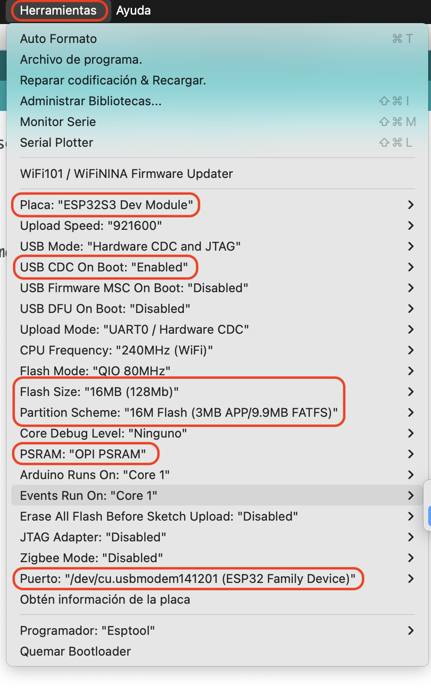

# Explicación del sketch 48_Audio

Este proyecto usa un ESP32-S3 para reproducir audio desde una tarjeta SD y un codec ES8311 por I2S. El sketch inicializa el hardware, prepara la salida de audio y ejecuta una demo musical automática.

## 1. Inclusiones y configuración

```cpp
#include <Arduino.h>
#include "driver_sdmmc.h"
#include "es8311.h"
#include "Audio.h"
#include "Wire.h"
#include "ESP_I2S.h"
#include "demo_music.h"
```

- `Arduino.h`: librería base de Arduino para funciones como `pinMode`, `digitalWrite`, `Serial`.
- `driver_sdmmc.h`: soporte para la inicialización de la tarjeta SD mediante SDMMC.
- `es8311.h`: driver del codec de audio ES8311.
- `Audio.h`: biblioteca para gestionar reproducción de archivos de audio por I2S.
- `Wire.h`: control del bus I2C para comunicar con el codec.
- `ESP_I2S.h`: biblioteca del bus I2S.
- `demo_music.h`: archivo con la música de ejemplo y funciones para reproducirla.

Las definiciones de placa seleccionan la configuración de pines correcta para la pantalla y el módulo audio:

```cpp
#define FNK0104AB_2P8_240x320_ILI9341
#define AP_ENABLE 1
#define I2C_SPEED 400000
```

- `FNK0104AB_2P8_240x320_ILI9341`: activa la configuración específica del panel TFT compatible con esta placa.
- `AP_ENABLE`: controla la alimentación del amplificador / audio.
- `I2C_SPEED`: define la rapidez del bus I2C a 400 kHz.

## 2. Pines GPIO

El sketch define los pines de la tarjeta SD y del bus I2S. Hay dos configuraciones posibles según la placa;
la versión activa en este ejemplo es la de `FNK0104AB_2P8_240x320_ILI9341`.

Ejemplo:

```cpp
#define SD_SCK 38
#define SD_CMD 40
#define SD_D0 39
#define SD_D1 41
#define SD_D2 48
#define SD_D3 47

#define I2S_MCK 4
#define I2S_BCK 5
#define I2S_DINT 6
#define I2S_DOUT 8
#define I2S_WS 7
#define I2C_SCL 15
#define I2C_SDA 16
```

Estos pins asignan:

- SD card: reloj, comando, datos y control de la tarjeta SD.
- I2S: reloj maestro, bit clock, data in/out, word select, etc.
- I2C: clock y data para el codec ES8311.

## 3. Objetos globales

```cpp
Audio audio;
I2SClass es8311_i2s;
```

- `audio`: instancia de la librería de audio para controlar reproducción, volumen y buffer.
- `es8311_i2s`: instancia del bus I2S usado para comunicar con el codec ES8311.

## 4. Función `driver_es8311_init()`

```cpp
void driver_es8311_init(void) {
  pinMode(AP_ENABLE, OUTPUT);
  digitalWrite(AP_ENABLE, LOW);

  Wire.begin(I2C_SDA, I2C_SCL, I2C_SPEED);

  es8311_i2s.setPins(I2S_BCK, I2S_WS, I2S_DOUT, I2S_DINT, I2S_MCK);
  if (!es8311_i2s.begin(I2S_MODE_STD, 44100, I2S_DATA_BIT_WIDTH_16BIT, I2S_SLOT_MODE_STEREO, I2S_STD_SLOT_LEFT)) {
    Serial.println("Failed to initialize I2S bus!");
  }
}
```

Esta función hace lo siguiente:

1. Configura el pin `AP_ENABLE` como salida.
2. Lo pone a nivel bajo para activar o desactivar la alimentación del módulo de audio.
3. Inicia el bus I2C usando SDA/SCL para hablar con ES8311.
4. Configura los pines del bus I2S.
5. Arranca el bus I2S con una frecuencia de 44.1 kHz, 16 bits y modo estéreo izquierdo.
6. Si falla, envía un mensaje por serial.

## 5. Función `setup()`

```cpp
void setup() {
  Serial.begin(115200);
  sdmmc_init(SD_SCK, SD_CMD, SD_D0, SD_D1, SD_D2, SD_D3);

  driver_es8311_init();
  if (es8311_codec_init() != ESP_OK) {
    Serial.println("ES8311 init failed!");
    return;
  }

  audio.setPinout(I2S_BCK, I2S_WS, I2S_DOUT, I2S_MCK);
  audio.setVolume(2);

  if (!demo_music()) {
    return;
  }

  demo_music_play(0);
}
```

La secuencia es:

- `Serial.begin(115200)`: activa la consola serial para depuración.
- `sdmmc_init(...)`: inicializa la tarjeta SD.
- `driver_es8311_init()`: prepara I2C e I2S del codec.
- `es8311_codec_init()`: inicializa el chip de audio ES8311.
- `audio.setPinout(...)`: asigna la salida de audio al puerto I2S physical.
- `audio.setVolume(2)`: ajusta el volumen.
- `demo_music()`: carga la música de ejemplo.
- `demo_music_play(0)`: reproduce la primera pista (índice 0).

Si la inicialización del codec falla, el programa sale de `setup()` y no sigue ejecutando la reproducción.

## 6. Función `loop()`

```cpp
void loop() {
  audio.loop();
}
```

Esta función se ejecuta continuamente en Arduino. Aquí se mantiene la librería `Audio` ejecutando tareas internas del sistema de reproducción, como:

- atender el buffer de audio,
- controlar la reproducción,
- procesar eventos del decodificador,
- mantener la salida activa.

## 7. Flujo general del programa

1. El ESP32 se inicia.
2. Inicializa la tarjeta SD.
3. Prepara el codec ES8311 y el bus I2S.
4. Configura la reproducción de audio.
5. Carga la demo musical.
6. Comienza a reproducir la pista 0.
7. En `loop()`, la librería sigue manejando el audio.

## 8. Observaciones útiles

- Este sketch está pensado para un módulo de audio con ES8311 y una pantalla TFT compatible con la placa.
- La línea `demo_music_play(0);` indica que se reproduce la primera pieza dentro del archivo de demo.
- El volumen está establecido en un valor bajo (`2`), útil para pruebas iniciales.
- Si el audio no suena, revisar:
  - conexión de pines I2S,
  - alimentación del codec,
  - configuración de la tarjeta SD,
  - selección del modelo de placa correcto,
  - voltajes y GND correctos.

## 9. Resumen corto

Es un sketch muy típico de audio en ESP32: inicializa SD + codec + I2S, carga una música de prueba y la reproduce en bucle de servicio con `audio.loop()`.

## 10. Configuración


